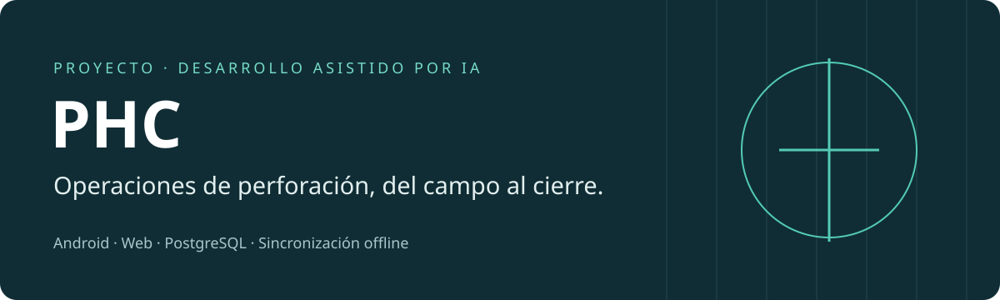
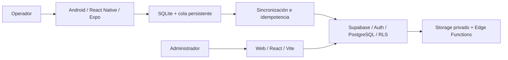

# PHC · Sistema de operaciones de perforación

**Un proyecto real desarrollado con asistencia intensiva de IA, presentado como
muestra de trabajo y aprendizaje.** Aplicación Android para el equipo de campo,
panel web para administración y backend PostgreSQL/Supabase.

El sistema organiza proyectos de perforación de pozos, turnos, avance, materiales,
pedidos y fichas de cierre. Su requisito central es conservar el trabajo cuando
la conexión a Internet es poco confiable.

> **Estado:** implementación en validación. Existen versiones desplegadas y pruebas
> controladas; quedan pendientes la aceptación completa en dispositivos físicos,
> la recuperación independiente y el piloto completo en un pozo real. Esta copia
> anonimizada es para revisión técnica y no está conectada al entorno del cliente.

## Mi participación

Soy Sergio. No me presento como programador tradicional: actualmente no sé escribir
ni leer código de forma independiente. Utilizo herramientas de IA para desarrollar
software a partir de necesidades reales.

Mi participación se centra en entender el problema, describir los procesos,
dirigir iteraciones con IA, probar comportamientos y dar seguimiento a errores y
pendientes. El código fue producido con asistencia intensiva de IA. La existencia
de este repositorio no implica que domine cada tecnología o pueda explicar cada
línea sin ayuda; sí permite examinar el resultado, las decisiones y sus límites.

## Recorrido para quien revisa

| Tiempo | Qué mirar |
|---|---|
| 2 minutos | Problema, alcance y arquitectura de esta página |
| 10 minutos | [Guía técnica con enlaces al código](docs/TECHNICAL_REVIEW.md) |
| 5 minutos | [Versiones, verificación y pendientes](docs/VERIFICATION.md) |
| Para ejecutar comprobaciones | [Preparación del entorno](docs/SETUP.md) |
| Para entender esta publicación | [Procedencia y anonimización](docs/SNAPSHOT.md) |

## Flujo de trabajo

**Proyecto → asignación de equipo → turno → avance y consumo → pedidos y recepción
→ conciliación → ficha técnica → revisión y firma.**

- **Campo:** registro de perforación, materiales, muestras, fotos y cierre de turno.
- **Administración:** proyectos, operadores, inventario, solicitudes y revisión.
- **Sin conexión:** persistencia SQLite y cola de operaciones para reintentar.
- **Integridad:** permisos y operaciones transaccionales comprobados en el backend.

## Arquitectura



| Área | Tecnología | Motivo |
|---|---|---|
| Aplicación Android | TypeScript, React Native, Expo | Interfaz móvil e integración con capacidades del dispositivo |
| Persistencia local | SQLite | Conservar registros y operaciones pendientes sin conexión |
| Administración web | React, TypeScript, Vite | Acceso administrativo desde navegador |
| Backend | PostgreSQL, Supabase, SQL/PLpgSQL | Datos relacionales, permisos y cambios atómicos |
| Verificación | Jest, pruebas web y SQL | Investigar errores y proteger comportamientos conocidos |

El antiguo servidor Express fue retirado. La solución actual utiliza Supabase;
esta copia incluye el esquema como migraciones y las funciones, no datos del cliente.

## Decisiones que vale la pena examinar

1. **Guardar antes de enviar.** Un registro local y su entrada en la cola deben
   persistir juntos; una pérdida de conexión no debe perder el trabajo.
2. **Reintentar sin duplicar efectos.** IDs generados por el cliente permiten
   identificar operaciones repetidas. No se presupone entrega de red exactamente una vez.
3. **Distinguir autor y usuario que sincroniza.** Una tableta compartida introduce
   casos distintos de una aplicación con un usuario por dispositivo.
4. **Separar aprobación y recepción.** Aprobar un pedido de Empresa no equivale a
   recibir materiales; la recepción es el paso que cambia el inventario asignado.
5. **Hacer explícitos los límites.** Una prueba en emulador no sustituye una prueba
   de campo y un backup exitoso no demuestra una restauración completa.

## Organización

```text
PHC_Mobile/phc-native/   Aplicación, sincronización, SQLite y pruebas
PHC_Web_Admin/          Panel web, reglas de presentación y pruebas
supabase/migrations/   Evolución ordenada del esquema y reglas del servidor
supabase/functions/    Operaciones privilegiadas y notificaciones
docs/                  Guía de revisión, configuración y evidencia
```

Esta publicación conserva nombres de dominio como `pedido`, `turno` y `ficha` para
que el código se pueda relacionar con la operación real. Los identificadores del
entorno productivo y los datos operativos no forman parte de la muestra.

**English:** PHC is an AI-assisted Android/web drilling-operations project. This
sanitized source snapshot demonstrates workflow design, offline synchronization,
backend business rules and verification practices. The author is transparent about
not yet being able to independently read or write code. Field acceptance remains
unfinished. See the technical review and verification documents for scope and evidence.
